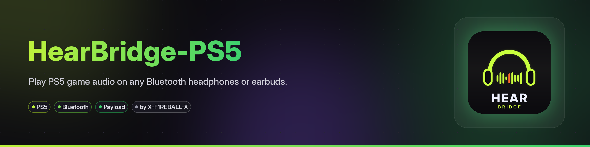
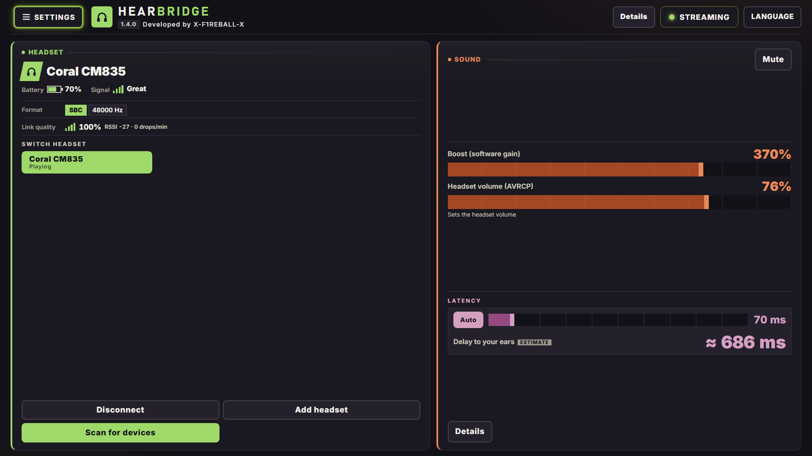
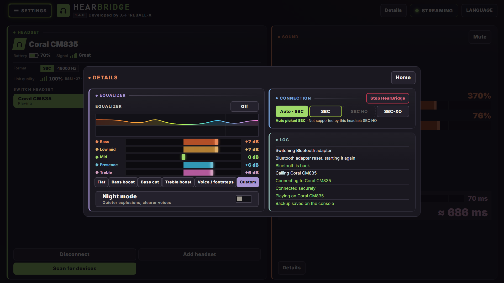
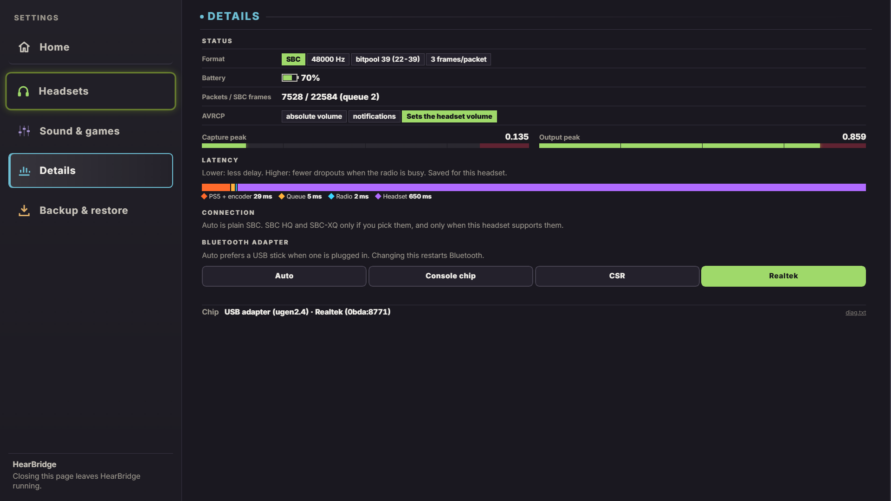

<div align="center">



**Bluetooth headphones for a jailbroken PS5: game and system audio, no dongle.**

Developed by **X-F1REBALL-X**

🇺🇸 **English** · 🇸🇦 [العربية](README.ar.md)

</div>

**HearBridge family:** [PS5](https://github.com/X-F1REBALL-X/HearBridge-PS5) · [PS4](https://github.com/X-F1REBALL-X/HearBridge-PS4) · [Browser](https://github.com/X-F1REBALL-X/HearBridge-Browser)

HearBridge PS5 is a payload (ELF) that plays your PS5's game and system audio on regular Bluetooth headphones, using the console's own Bluetooth or a USB stick. You control it from a web page served by the console.

<p align="center">


</p>
<p align="center">

</p>

## Highlights

- One file for every PS5 (Marvell/NXP or MediaTek Bluetooth).
- **USB Bluetooth adapters:** Realtek RTL8761BU (bundled firmware) and CSR8510, plus the console chip.
- **Adapter picker** in Settings with instant switching; one pairing shared across adapters.
- Single-screen UI for a 1080p TV: larger controls, Details panel for EQ, codecs and the log.
- Game profiles, battery percent, night mode and one-tap headset switching.

## Install

1. Download **HearBridge-1.4.0.elf** from the [latest release](https://github.com/X-F1REBALL-X/HearBridge-PS5/releases/latest).
2. Send it to your ELF loader on port 9021.
3. Open **http://&lt;console-ip&gt;:8090** or the **HearBridge** tile, then pair your headphones in **Settings**.

Everything else, from features to troubleshooting, is in the **[guide](https://x-f1reball-x.github.io/HearBridge-PS5/)**.

## USB Bluetooth adapter

Plug in a USB stick and HearBridge can use it instead of the console chip. The stick is not shared with the DualSense, so the controller keeps connecting normally while audio streams.

Supported sticks today:

- **Realtek RTL8761BU** (UB500 / UB600, USB id `0BDA:B00C` / `0BDA:8771`) — firmware is **bundled in the ELF** and written to `/data/hearbridge/firmware/` on start.
- **CSR8510** — works as a plain USB HCI adapter, no extra firmware.

Under **Settings → Details → Bluetooth adapter** pick **Auto**, **Console chip**, or a listed stick (for example Realtek / CSR). The change is saved to `/data/hearbridge/adapter` and Bluetooth restarts right away. Pairing is shared across adapters, so you do not have to pair the same headset again after switching.

You can still set the preference by hand with one line in `/data/hearbridge/adapter`:

```text
auto        # USB stick when present, else the console chip
internal    # always the console chip
usb         # always a USB adapter
ugen1.2     # one specific ugen node
```

### Realtek ROM-only adapters

Some Realtek sticks start in ROM mode and need a patch before they can scan. HearBridge uploads it the same way Linux `btrtl` does. For RTL8761BU the files are bundled:

```text
/data/hearbridge/firmware/rtl8761bu_fw.bin
/data/hearbridge/firmware/rtl8761bu_config.bin
```

Other Realtek USB parts the loader knows still need their blobs from
[`linux-firmware` `rtl_bt`](https://git.kernel.org/pub/scm/linux/kernel/git/firmware/linux-firmware.git/tree/rtl_bt)
placed under `/data/hearbridge/firmware/`. Only RTL8761BU has been tested on hardware.

## Build

```sh
export PS5_PAYLOAD_SDK=/opt/ps5-payload-sdk   # ps5-payload-sdk v0.43
make ps5      # dist/HearBridge-<version>.elf
make test
```

## Credits

MediaTek scan-pause and USB pipe fix, plus HCI debug tool, by [ZiZc3](https://github.com/ZiZc3) ([#6](https://github.com/X-F1REBALL-X/HearBridge-PS5/pull/6))

USB Bluetooth adapter path and Realtek ROM uploader by [jamesst20](https://github.com/jamesst20) ([#45](https://github.com/X-F1REBALL-X/HearBridge-PS5/pull/45))

Bundled RTL8761BU firmware blobs are from the
[linux-firmware](https://git.kernel.org/pub/scm/linux/kernel/git/firmware/linux-firmware.git/tree/rtl_bt)
`rtl_bt` tree (Realtek Semiconductor Corporation). See
[assets/firmware/LICENCE.rtlwifi_firmware.txt](assets/firmware/LICENCE.rtlwifi_firmware.txt).

## License

GPL-3.0-or-later. See [LICENSE](LICENSE) and [NOTICE](NOTICE).

[Support the project on Ko-fi](https://ko-fi.com/xf1reballx). The project stays free and open source.
