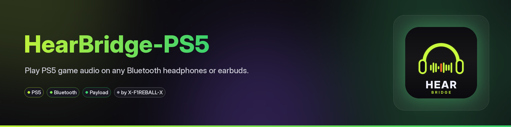
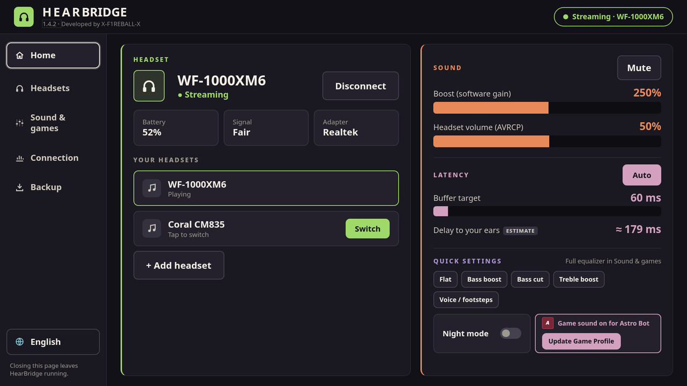
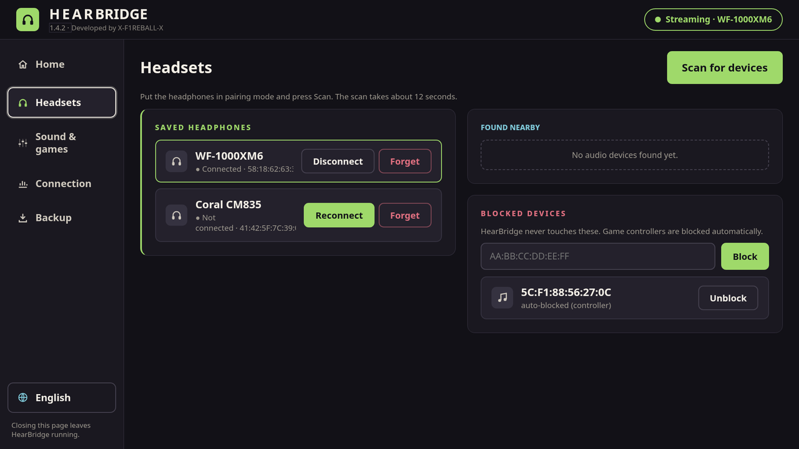
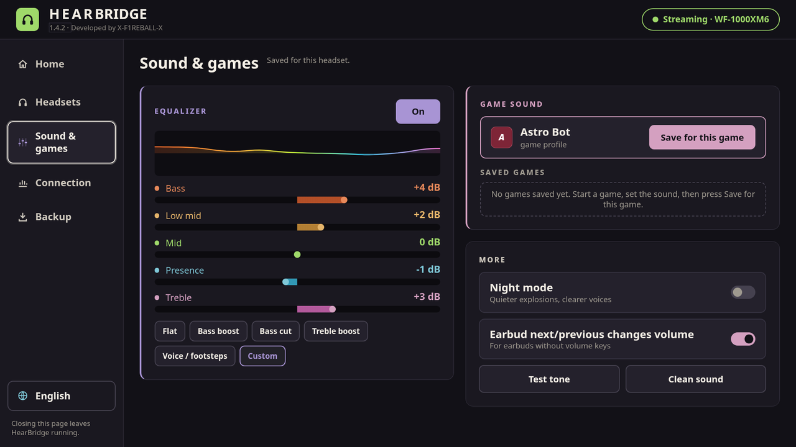
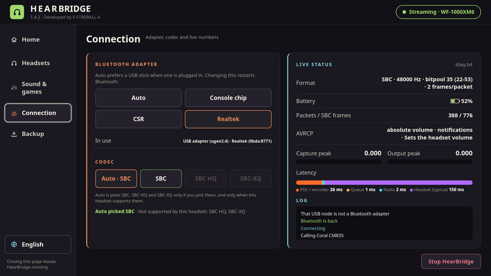

<div align="center">



**Bluetooth headphones for a jailbroken PS5: game and system audio, on the console chip or a USB dongle.**

Developed by **X-F1REBALL-X**

</div>

**HearBridge family:** [PS5](https://github.com/X-F1REBALL-X/HearBridge-PS5) · [PS4](https://github.com/X-F1REBALL-X/HearBridge-PS4) · [Browser](https://github.com/X-F1REBALL-X/HearBridge-Browser)

HearBridge PS5 is a payload (ELF) that plays your PS5's game and system audio on regular Bluetooth headphones, using the console's own Bluetooth or a USB stick. You control it from a web page served by the console.

<table align="center">
<tr>
<td></td>
<td></td>
</tr>
<tr>
<td></td>
<td></td>
</tr>
</table>

## Highlights

- One file for every PS5 (Marvell/NXP or MediaTek Bluetooth).
- **USB Bluetooth adapters:** Realtek RTL8761BU (bundled firmware) and CSR8510, plus the console chip.
- **Adapter picker** in Settings with instant switching; one pairing shared across adapters.
- Headset connect and disconnect auto mode.
- Interface layout updates for TV use.
- Optional **ESP32-S3** board that shows up on the PS5 as USB headphones, so Tempest 3D Audio can turn on while HearBridge still sends the sound to your real Bluetooth headset.
- Side menu (Home, Headsets, Sound & games, Connection, Backup) that fits the TV with no scrolling, plus a phone layout with a bottom menu.
- Game profiles, battery percent, night mode and one-tap headset switching.

## Install

1. Download **HearBridge-1.4.3.elf** from the [latest release](https://github.com/X-F1REBALL-X/HearBridge-PS5/releases/latest).
2. Send it to your ELF loader on port 9021.
3. Open **http://&lt;console-ip&gt;:6767** or the **HearBridge** tile, then pair your headphones in **Settings**.

Everything else, from features to troubleshooting, is in the **[guide](https://x-f1reball-x.github.io/HearBridge-PS5/)**.

## Optional: ESP32-S3 for Tempest 3D Audio

The PS5 only fills its USB audio path while a USB headset is selected. A small ESP32-S3 board can act as that headset: plug it into the PS5 over USB, pick **USB Headphones (PS5 Audio Sink)** in Sound settings, and Tempest 3D Audio can turn on. HearBridge still streams the mix to your real Bluetooth headphones.

Board tested: **ESP32-S3 DevKitC-1** (N16R8).

1. Download **ESP32-S3-PS5-Audio-Sink.bin** from the [latest release](https://github.com/X-F1REBALL-X/HearBridge-PS5/releases/latest).
2. Flash it to the ESP32-S3 UART port at offset `0x0` (esptool, or [esptool-js](https://espressif.github.io/esptool-js/) in a browser).
3. Plug the board's USB-OTG port into the PS5, select **USB Headphones (PS5 Audio Sink)** as the output, and in HearBridge set capture to USB audio.

Full build and flash notes are in `tools/esp32-sink`.

## Internal chip vs USB dongle

The DualSense always uses the console's internal Bluetooth chip. If HearBridge streams audio over that same chip, the controller and the headphones share one radio. This can cause audio stutter, controller disconnects, and controllers that can't reconnect until a reboot.

**For gaming, use a USB Bluetooth dongle.** The controller stays on the internal chip and the headphones run on the dongle, so both stay stable.

The internal chip works fine without a controller, for example for media or Remote Play.

## USB Bluetooth adapter

Plug in a USB stick and HearBridge can use it instead of the console chip. The stick is not shared with the DualSense, so the controller keeps connecting normally while audio streams.

Supported sticks today:

- **Realtek RTL8761BU**, including rebadged sticks like TP-Link UB500 / UB600 and ASUS BT600. The chip is detected from the stick itself, not the USB id. Firmware is **bundled in the ELF** and written to `/data/hearbridge/firmware/` on start.
- **CSR8510**, works as a plain USB HCI adapter with no extra firmware.

Under **Settings → Details → Bluetooth adapter** pick **Auto**, **Console chip**, or a listed stick (for example Realtek / CSR). The change is saved to `/data/hearbridge/adapter` and Bluetooth restarts right away. Pairing is shared across adapters, so you do not have to pair the same headset again after switching.

You can still set the preference by hand with one line in `/data/hearbridge/adapter`:

```text
auto        # USB stick when present, else the console chip
internal    # always the console chip
usb         # always a USB adapter
ugen1.2     # one specific ugen node
```

### Realtek ROM-only adapters

Some Realtek sticks start in ROM mode and need a patch before they can scan. HearBridge uploads it the same way Linux `btrtl` does. For RTL8761BU the files are bundled:

```text
/data/hearbridge/firmware/rtl8761bu_fw.bin
/data/hearbridge/firmware/rtl8761bu_config.bin
```

Other Realtek USB parts the loader knows still need their blobs from
[`linux-firmware` `rtl_bt`](https://git.kernel.org/pub/scm/linux/kernel/git/firmware/linux-firmware.git/tree/rtl_bt)
placed under `/data/hearbridge/firmware/`. Only RTL8761BU has been tested on hardware.

## Build

```sh
export PS5_PAYLOAD_SDK=/opt/ps5-payload-sdk   # ps5-payload-sdk v0.43
make ps5      # dist/HearBridge-<version>.elf
make test
```

## Credits

MediaTek scan-pause and USB pipe fix, plus HCI debug tool, by [ZiZc3](https://github.com/ZiZc3) ([#6](https://github.com/X-F1REBALL-X/HearBridge-PS5/pull/6))

USB Bluetooth adapter path and Realtek ROM uploader by [jamesst20](https://github.com/jamesst20) ([#45](https://github.com/X-F1REBALL-X/HearBridge-PS5/pull/45))

Realtek detection by chip identity by [jamesst20](https://github.com/jamesst20) ([#51](https://github.com/X-F1REBALL-X/HearBridge-PS5/pull/51))

SBC build fix for newer compilers by [keravyn-ops](https://github.com/keravyn-ops) ([#47](https://github.com/X-F1REBALL-X/HearBridge-PS5/pull/47))

Bundled RTL8761BU firmware blobs are from the
[linux-firmware](https://git.kernel.org/pub/scm/linux/kernel/git/firmware/linux-firmware.git/tree/rtl_bt)
`rtl_bt` tree (Realtek Semiconductor Corporation). See
[assets/firmware/LICENCE.rtlwifi_firmware.txt](assets/firmware/LICENCE.rtlwifi_firmware.txt).

## License

GPL-3.0-or-later. See [LICENSE](LICENSE) and [NOTICE](NOTICE).

[Support the project on Ko-fi](https://ko-fi.com/xf1reballx). The project stays free and open source.
